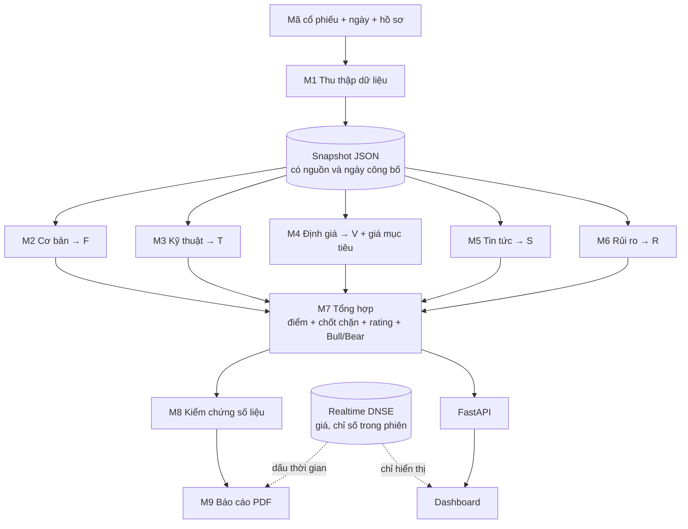

<div align="center">

# StockAI

### Hệ thống phân tích cơ hội đầu tư cổ phiếu Việt Nam

**Một mã cổ phiếu · hai phong cách đầu tư · năm trụ cột chấm điểm · một báo cáo PDF có dẫn chứng.**

*Mọi con số đều truy được nguồn. AI chỉ diễn giải, không bịa số.*


[Giới thiệu](#1-stockai-là-gì) · [Điểm nhấn](#2-điểm-nhấn) · [Dùng thử 5 phút](#4-dùng-thử-trong-5-phút) · [Hướng dẫn sử dụng](#5-hướng-dẫn-sử-dụng-dashboard) · [Bóc tách từng lớp](#7-bóc-tách-hệ-thống-từng-lớp) · [Cho lập trình viên](#11-dành-cho-lập-trình-viên)

</div>

> **Tuyên bố miễn trừ.** StockAI là sản phẩm phục vụ học tập và nghiên cứu. Điểm số và khuyến nghị mang tính minh họa, chưa được hiệu chỉnh hay backtest, **không phải lời khuyên đầu tư**. Mọi quyết định mua bán là của bạn.

---

## 1. StockAI là gì?

Khi muốn biết *"có nên quan tâm đến cổ phiếu HPG lúc này không?"*, một nhà đầu tư cá nhân thường phải mở nhiều nơi: bảng giá, báo cáo tài chính, biểu đồ kỹ thuật, tin tức, rồi tự tổng hợp trong đầu. Kết quả dễ thiên lệch, khó lặp lại và khó giải thích cho người khác.

**StockAI gom toàn bộ quy trình đó vào một chỗ và làm cho nó minh bạch:**

1. **Thu thập** dữ liệu giá, báo cáo tài chính, tin tức, hồ sơ công ty và so sánh với doanh nghiệp cùng ngành.
2. **Chấm điểm** theo năm trụ cột độc lập: *Cơ bản, Kỹ thuật, Định giá, Tin tức, Rủi ro*.
3. **Tổng hợp** thành một điểm 0–100 và một trong 5 khuyến nghị, theo **hồ sơ nhà đầu tư** của bạn (dài hạn hay lướt sóng).
4. **Giải thích** bằng lập luận Bull/Bear (lý do nên và không nên), mỗi ý dẫn về số liệu cụ thể.
5. **Kiểm chứng** lại chính kết quả của mình, rồi **xuất báo cáo PDF** kèm dữ liệu thị trường tại thời điểm xuất.

Bạn có thể dùng nó như:

| Bạn là | StockAI giúp bạn |
|---|---|
| Nhà đầu tư cá nhân | Sàng lọc nhanh toàn bộ mã đã chấm điểm, so sánh tối đa 4 mã cạnh nhau, đọc lập luận Bull/Bear và biết mỗi con số đến từ đâu |
| Sinh viên, người học tài chính | Xem một quy trình phân tích hoàn chỉnh (dữ liệu → chỉ báo → định giá → khuyến nghị) với công thức mở, đổi trọng số bằng file cấu hình và thấy kết quả đổi theo |
| Giảng viên, người hướng dẫn | Có sản phẩm mẫu để thảo luận về phương pháp, giới hạn mô hình, rủi ro look-ahead và cách trình bày kết quả có trách nhiệm |
| Lập trình viên | Một pipeline module hóa rõ ràng (`run(snapshot, upstream, cfg) -> dict`), có API, test và tài liệu để mở rộng |

---

## 2. Điểm nhấn

| | Điều làm StockAI khác một bảng điểm thông thường |
|---|---|
| **Minh bạch đến từng con số** | Mỗi chỉ số mang theo nguồn và ngày công bố. Công thức, trọng số, ngưỡng đều nằm trong file cấu hình và hiển thị ngay trên trang **Phương pháp**. |
| **AI không được bịa số** | Điểm, giá mục tiêu và khuyến nghị do **code** tính từ dữ liệu. Mô hình ngôn ngữ chỉ viết lập luận, và lập luận bị kiểm tra: ý nào dẫn tới số không có thật sẽ bị loại. |
| **Chặn nhìn trước tương lai (look-ahead)** | Phân tích "tại ngày X" chỉ dùng thông tin đã công bố đến ngày X, nên kết quả tái lập được và công bằng. |
| **Hai hồ sơ nhà đầu tư** | Cùng một cổ phiếu, `long_term` coi trọng cơ bản và định giá, `swing` coi trọng kỹ thuật. Điểm và khuyến nghị đổi theo. |
| **Định giá có cảnh báo trung thực** | Giá mục tiêu kết hợp P/E–P/B so với ngành và DCF. Khi con số lệch xa giá thị trường, hệ thống **nói thẳng là kém tin cậy** thay vì giả vờ chắc chắn. |
| **Biết tự nghi ngờ** | Có chốt chặn rủi ro (R cao thì không quá "Nắm giữ"), chốt chặn dữ liệu (mã thanh khoản thấp, upside bất thường) và bước M8 kiểm tra lại chính kết quả. |
| **Realtime nhưng không làm hỏng điểm số** | Giá và VN-Index chạy trực tiếp trong phiên (DNSE) để bạn theo dõi, còn điểm số luôn tính trên giá đóng cửa để không dao động theo từng tick. |
| **PDF "đúng thời điểm"** | Báo cáo xuất ngày nào mang dữ liệu thị trường của đúng thời điểm đó, kèm ngày xuất theo giờ Việt Nam. |
| **Tự cập nhật** | API tự nhận dữ liệu ngày mới (không cần khởi động lại) và giao diện cảnh báo khi dữ liệu cuối ngày đã cũ. |

---

## 3. Xem nhanh sản phẩm

```
┌───────────────────────────────────────────────────────────────────────────┐
│ VN-Index 1.698,35  -0,38%   ● Trực tiếp · Phiên chiều   ▲ 112 ■ 38 ▼ 85   │
├───────────────────────────────────────────────────────────────────────────┤
│ VIC · VinGroup          Giá           Điểm tổng hợp   Khuyến nghị   Mục tiêu│
│ HSX · Real Estate       218.000 ₫     27,4 / 100      Bán           29.088 ₫│
│                         -0,18%        [Long-term|Swing]             ⚠ kém tin cậy│
├───────────────────────────────┬───────────────────────────────────────────┤
│ Biểu đồ nến + MA + RSI + MACD │ Radar 5 trụ cột: F · T · V · S · R        │
├───────────────────────────────┴───────────────────────────────────────────┤
│ Tin tiêu biểu & sắc thái │ Lập luận Bull/Bear │ [ Xuất báo cáo PDF ]       │
└───────────────────────────────────────────────────────────────────────────┘
```
*(Bố cục minh họa. Bản phác thiết kế ban đầu: [`docs/image/wireframe.png`](docs/image/wireframe.png).)*

---

## 4. Dùng thử trong 5 phút

Bạn **không cần** API key nào để xem dashboard: repo đã kèm sẵn dữ liệu snapshot đã chốt trong `data/snapshots/`.

**Bước 1. Cài đặt** (cần Python 3.10 trở lên)

```bash
git clone https://github.com/Levianth146/Stock-investment-opportunity-analysis-system.git
cd Stock-investment-opportunity-analysis-system
git checkout develop

python -m venv .venv
source .venv/bin/activate          # Windows PowerShell: .venv\Scripts\Activate.ps1
pip install -r requirements.txt
```

**Bước 2. Khởi động**

```bash
python scripts/run_api.py
```

**Bước 3. Mở trình duyệt** tại **http://127.0.0.1:8000/**. Giao diện đã được build sẵn trong `frontend/dist`, không cần cài Node.

Chờ vài chục giây lần đầu để hệ thống nạp bộ nhớ đệm (`/api/health` trả `warming` rồi chuyển `ok`). Tài liệu API tương tác: **http://127.0.0.1:8000/docs**.

**Bước 4 (tùy chọn). Bật realtime và LLM**: sao chép `.env.example` thành `.env` và điền key, xem [mục 9](#9-cấu-hình-và-biến-môi-trường). Thiếu key thì hệ thống vẫn chạy bình thường với giá đóng cửa và lập luận dạng mẫu.

**Thử nhanh bằng dòng lệnh** (không cần mở web):

```bash
python main.py DEMO --profile long_term --snapshot fixtures/snapshot_DEMO.json   # dữ liệu giả, chạy ngay
python main.py HPG --profile swing --as-of 2026-10-15                              # tự thu thập dữ liệu rồi ra PDF trong reports/
```

---

## 5. Hướng dẫn sử dụng dashboard

Thanh bên trái có 9 mục. Phía trên cùng mỗi trang là **thanh thị trường** (VN-Index, % thay đổi, trạng thái phiên, độ rộng tăng/giảm). Nếu dữ liệu cuối ngày cũ hơn phiên gần nhất, một dải cảnh báo vàng sẽ xuất hiện.

### 5.1 Chọn mã và hồ sơ
Bấm ô **Mã cổ phiếu** để tìm (gõ mã hoặc tên, không cần dấu). Chọn **Long-term** (đầu tư dài hạn) hoặc **Swing** (lướt sóng ngắn hạn), rồi bấm **Phân tích ngay**. Hai hồ sơ cho điểm khác nhau vì trọng số khác nhau.

### 5.2 Đọc phần đầu trang: giá, điểm, khuyến nghị, giá mục tiêu
| Ô | Ý nghĩa |
|---|---|
| **Giá** | Trong phiên: nhãn "Giá trực tiếp". Ngoài phiên: "Giá đóng cửa", kèm % thay đổi so với phiên liền trước. |
| **Điểm tổng hợp /100** | 50 là trung tính. Càng cao càng thuận lợi theo hồ sơ bạn chọn. |
| **Khuyến nghị** | Mua mạnh, Mua, Nắm giữ, Giảm tỷ trọng hoặc Bán, suy ra từ điểm và các chốt chặn. |
| **Giá mục tiêu cơ sở** | Giá hàm ý từ định giá. Dòng "Kém tin cậy" xuất hiện khi con số lệch xa giá thị trường: hãy coi nó là tham khảo. |

> **Nhớ:** giá trực tiếp chỉ để theo dõi. Điểm số luôn tính trên giá đóng cửa, nên không nhảy theo từng tick.

### 5.3 Các trang
| Trang | Dùng để | Mẹo |
|---|---|---|
| **Tổng quan** | Nhìn toàn cảnh một mã: giá, nến, MA/RSI/MACD, radar 5 trụ cột, tin tiêu biểu, nút xuất PDF | Rê chuột lên biểu đồ để xem giá từng phiên; đổi 1 tháng đến 1 năm |
| **Phân tích cổ phiếu** | Đi sâu từng trụ cột: cơ bản, kỹ thuật, định giá (P/E, P/B, so ngành, **tab DCF**), rủi ro, kiểm chứng | Tab **DCF** hiện dự phóng dòng tiền, WACC, bảng độ nhạy và mọi giả định |
| **Cơ hội đầu tư** | Lọc toàn bộ mã đã xếp hạng theo sàn, ngành, vốn hóa, điểm tối thiểu, nhóm rủi ro, chênh lệch mục tiêu, khối lượng, khuyến nghị | Xuất CSV theo bộ lọc; chiến lược mặc định là F, T, V đều từ 65 |
| **Danh mục theo dõi** | Gắn sao các mã, nhập số lượng, giá vốn, ngưỡng cảnh báo, xem giá trị, lãi lỗ, phân bổ ngành, biến động | Dữ liệu lưu **trên trình duyệt của bạn**, không gửi đi đâu và không đặt lệnh giao dịch |
| **So sánh mã** | Đặt tối đa **4 mã** cạnh nhau theo điểm, từng trụ cột, định giá, rủi ro | Ô tốt nhất mỗi hàng được nhấn nổi |
| **Phương pháp** | Xem công thức, trọng số, ngưỡng rating và các chốt chặn đang áp dụng | Đọc thẳng từ cấu hình thật, đổi file cấu hình là trang đổi theo |
| **Báo cáo PDF** | Xuất và tải báo cáo | Xem [mục 5.5](#55-xuất-báo-cáo-pdf) |
| **Tin tức** | Tin theo mã kèm sắc thái (tích cực, tiêu cực, trung tính) | Sắc thái chỉ là phân loại tiêu đề, không dự báo giá |
| **Lịch sử** | Các phân tích đã xem | |

### 5.4 Hiểu các nhãn và cảnh báo thường gặp
| Bạn thấy | Nghĩa là |
|---|---|
| **● Trực tiếp** | Giá đang cập nhật từ sàn trong phiên. |
| **Đóng cửa (tạm tính)** | Phiên vừa kết thúc, đang dùng giá chốt trong khi chờ dữ liệu cuối ngày chính thức. |
| **Giá đóng cửa snapshot** | Không có luồng trực tiếp (không có key, ngoài giờ hoặc lỗi kết nối), đang dùng dữ liệu đã lưu. |
| **Dữ liệu EOD đang ở phiên …** (dải vàng) | Dữ liệu cuối ngày cũ hơn phiên giao dịch gần nhất, cần chạy làm mới (xem [mục 8](#8-vận-hành-hằng-ngày)). |
| **Kém tin cậy: giá mục tiêu lệch xa giá thị trường** | Giá mục tiêu nhỏ hơn 0,4 hoặc lớn hơn 2,5 lần giá. Thường gặp ở tập đoàn đa ngành hoặc mã đang giao dịch với premium cao so với trung vị ngành. |
| **Bậc dữ liệu `limited` / `insufficient`** | Mã thanh khoản thấp hoặc thiếu báo cáo. `limited` bị giới hạn mức khuyến nghị tối đa, `insufficient` không được chấm điểm. |

### 5.5 Xuất báo cáo PDF
- **Cách 1:** bấm **Xuất báo cáo PDF** ở Tổng quan hoặc vào trang **Báo cáo PDF**.
- **Cách 2:** mở trực tiếp `http://127.0.0.1:8000/api/report/HPG.pdf?profile=long_term` (thêm `&technical=true` để có phụ lục kỹ thuật).
- Mất vài giây. Tên file `{MÃ}_{ngày xuất}_{profile}.pdf`, ngày theo giờ Việt Nam.
- Báo cáo có **khối "Dữ liệu thời gian thực tại thời điểm xuất"**: giá trực tiếp hoặc giá chốt phiên, VN-Index, độ rộng thị trường và thời điểm lấy dữ liệu. Nếu lúc xuất không có luồng trực tiếp, báo cáo ghi rõ điều đó và dùng giá đóng cửa.
- Xuất PDF **không gọi LLM** và không tốn hạn mức: phần tranh luận là bản dựng từ số liệu (hoặc bản LLM đã lưu từ trước nếu có).

---

## 6. Cách StockAI ra quyết định

### 6.1 Sơ đồ tổng thể


### 6.2 Công thức điểm
```
Điểm = clamp( 50 + Σ  w_X · (X − 50)  −  λ · (R − 50),  0, 100 )          X ∈ { F, T, V, S }
```
Mỗi trụ cột cho điểm 0–100 (50 là trung tính). Trụ cột càng trên 50 thì cộng điểm, rủi ro R càng trên 50 thì **trừ** điểm.

| Hồ sơ | F Cơ bản | T Kỹ thuật | V Định giá | S Tin tức | λ phạt rủi ro | Phù hợp với |
|---|---|---|---|---|---|---|
| `long_term` | 0,30 | 0,10 | **0,35** | 0,25 | 0,2 | Nắm giữ nhiều tháng đến nhiều năm |
| `swing` | 0,15 | **0,45** | 0,20 | 0,20 | 0,3 | Giao dịch ngắn hạn theo xu hướng |

### 6.3 Từ điểm đến khuyến nghị
| Điểm | Khuyến nghị |
|---|---|
| ≥ 75 | **Mua mạnh** |
| ≥ 60 | **Mua** |
| ≥ 45 | **Nắm giữ** |
| ≥ 30 | **Giảm tỷ trọng** |
| < 30 | **Bán** |

### 6.4 Các chốt chặn (tự nghi ngờ chính mình)
| Chốt chặn | Điều kiện | Hệ quả |
|---|---|---|
| **Risk gate** | R ≥ 70 (rủi ro cao) | Khuyến nghị tối đa là "Nắm giữ" |
| **Data gate: thanh khoản** | Mã bậc `limited` | Tối đa "Mua", không có "Mua mạnh" |
| **Data gate: upside bất thường** | Giá mục tiêu cao hơn giá hơn 100% | Tối đa "Nắm giữ" (nghi lệch dữ liệu hoặc "bẫy giá trị") |
| **Thiếu dữ liệu** | Bậc `insufficient` | Không chấm điểm, không có giá mục tiêu |
| **Cảnh báo giá mục tiêu** | Giá mục tiêu ngoài 0,4–2,5 lần giá | Hiển thị cảnh báo "kém tin cậy" |

Toàn bộ số trên nằm trong `config/scoring.yaml` và `config/valuation.yaml`. Đổi file là đổi hành vi, không cần sửa code.

---

## 7. Bóc tách hệ thống từng lớp

Hệ thống có **bốn lớp**, mỗi lớp chỉ phụ thuộc lớp bên dưới.

```
 ┌──────────────────────────────────────────────────────────────┐
 │ 4. TRÌNH BÀY    Dashboard React · Báo cáo PDF (M9)            │
 ├──────────────────────────────────────────────────────────────┤
 │ 3. DỊCH VỤ      FastAPI · Realtime Hub · bộ nhớ đệm · SSE     │
 ├──────────────────────────────────────────────────────────────┤
 │ 2. PHÂN TÍCH    M2 · M3 · M4 · M5 · M6 → M7 → M8              │
 ├──────────────────────────────────────────────────────────────┤
 │ 1. DỮ LIỆU      M1 → Snapshot JSON (nguồn, ngày công bố)      │
 └──────────────────────────────────────────────────────────────┘
```

### Lớp 1. Dữ liệu (M1)
**Việc làm:** thu thập giá lịch sử, chỉ số VN-Index, báo cáo tài chính năm và quý, hồ sơ công ty, cổ tức, tin tức và danh sách doanh nghiệp cùng ngành; đối chiếu chéo nguồn; gắn **bậc chất lượng**.

**Đầu ra:** một file **snapshot** `data/snapshots/{MÃ}_{YYYY-MM-DD}.json` cho mỗi mã mỗi ngày. Snapshot là "bức ảnh chụp" dữ liệu tại một ngày, nên cùng snapshot thì luôn ra cùng kết quả.

| Bậc chất lượng | Ý nghĩa | Được chấm điểm? |
|---|---|---|
| `full` | Đủ giá, báo cáo, tin, so sánh ngành | Có |
| `limited` | Thanh khoản thấp hoặc dữ liệu mỏng | Có, nhưng bị giới hạn mức tối đa |
| `insufficient` | Thiếu dữ liệu cốt lõi | Không |

### Lớp 2. Phân tích (M2 đến M8)
| Mô-đun | Câu hỏi nó trả lời | Cách làm | Ra |
|---|---|---|---|
| **M2 Cơ bản** | Doanh nghiệp có khỏe không? | Phi ngân hàng: ROE (25%), tăng trưởng lợi nhuận (20%), nợ/vốn chủ (20%), chất lượng dòng tiền CFO/LNST (20%), khả năng trả lãi (15%). Ngân hàng dùng bộ riêng: ROE, tăng trưởng, NIM, CIR, dư nợ/huy động. Thêm bộ kiểm tra Piotroski F-score. | **F** |
| **M3 Kỹ thuật** | Xu hướng giá đang ra sao? | Điểm theo rubric: xu hướng (35), động lượng RSI/MACD (30), khối lượng (20), biến động ATR (15). Dùng MA20/50/200. | **T** |
| **M4 Định giá** | Giá đang rẻ hay đắt? | P/E và P/B so với trung vị **ngành** (xếp phân vị trong ngành), cộng DCF dòng tiền tự do doanh nghiệp (FCFF). Ra điểm V và giá mục tiêu có khoảng Bear/Bull. | **V**, giá mục tiêu |
| **M5 Tin tức** | Tin gần đây tích cực hay tiêu cực? | Phân loại **tiêu đề** bằng từ điển tiếng Việt (không dùng LLM), trọng số giảm dần theo thời gian (bán rã 14 ngày, cửa sổ 60 ngày), gom cụm tin trùng, loại tin chung chung về thị trường. | **S** |
| **M6 Rủi ro** | Cổ phiếu biến động và sụt giảm nặng cỡ nào? | Biến động năm 25%, sụt giảm tối đa 25%, VaR95 20%, CVaR95 15%, beta 15%, trên 252 phiên. R cao = rủi ro cao. | **R** |
| **M7 Tổng hợp** | Gộp lại thì sao? | Công thức điểm, trọng số theo hồ sơ, các chốt chặn, 5 mức khuyến nghị, lập luận Bull/Bear. | Điểm, rating, giá mục tiêu |
| **M8 Kiểm chứng** | Kết quả có đáng tin không? | Bằng code, không LLM: soát look-ahead, trạng thái nguồn, điểm trong 0–100, số hữu hạn, nguồn trích dẫn có thật, **tính lại** điểm và rating của M7, giá mục tiêu chỉ đến từ M4. | Báo cáo kiểm tra |

**Định giá chi tiết (M4):**
- *Tương đối:* giá hàm ý = trung vị P/E và P/B của ngành × EPS và giá trị sổ sách của chính mã (ngân hàng dựa vào P/B).
- *DCF (FCFF hai giai đoạn):* FCFF = CFO + lãi vay sau thuế − CAPEX; dự phóng vài năm với tăng trưởng giảm dần về mức dài hạn; chiết khấu bằng WACC theo CAPM. Không áp dụng cho ngân hàng, chứng khoán, bảo hiểm.
- *Giá mục tiêu:* 70% tương đối + 30% DCF, **chỉ khi** DCF qua cổng hợp lý (0,25–4 lần giá thị trường).
- Giả định DCF là minh họa. Xem [`docs/M4_DCF.md`](docs/M4_DCF.md).

**Lập luận Bull/Bear:** lấy từ số liệu của các mô-đun. Mô hình ngôn ngữ (Gemini, GLM) chỉ được dùng, theo yêu cầu, để *diễn đạt* lập luận; mỗi ý phải dẫn về mã tham chiếu có thật, ý không dẫn chứng bị loại. Mọi lỗi LLM đều lùi về bản dựng sẵn từ số liệu.

### Lớp 3. Dịch vụ (FastAPI và Realtime)
| Thành phần | Vai trò |
|---|---|
| **API (`src/stockai/api`)** | Đọc kết quả pipeline, trả JSON cho giao diện. Tự quét thư mục snapshot mỗi 60 giây để nhận dữ liệu ngày mới mà không cần khởi động lại. |
| **Bộ nhớ đệm** | Kết quả M2–M8 theo (mã, hồ sơ, ngày, cấu hình, thời điểm sửa snapshot). Tự vô hiệu khi dữ liệu hoặc cấu hình đổi. |
| **Realtime Hub (DNSE)** | Luồng WebSocket nền cho ~235 mã thanh khoản: giá, %, khối lượng, VN-Index, độ rộng, heatmap. Đẩy xuống giao diện bằng SSE, hoặc poll 8 giây (mở cửa) và 30 giây (đóng cửa) khi SSE không dùng được. Lưu giá trong phiên xuống `data/intraday` để sống qua việc khởi động lại. Chỉ đọc market data, không đụng tài khoản hay lệnh. |
| **Giới hạn và an toàn** | API chỉ lắng nghe `127.0.0.1`; giới hạn tần suất và hạn mức ngày cho phần gọi LLM; không in key. |

### Lớp 4. Trình bày
- **Dashboard** (`frontend/`): React 19 và Tailwind. Gồm các trang ở [mục 5](#5-hướng-dẫn-sử-dụng-dashboard), thanh thị trường trực tiếp và cảnh báo EOD cũ.
- **Báo cáo PDF (M9):** dựng bằng ReportLab và Matplotlib. Có bìa, trang tóm tắt định vị đầu tư, các trang cơ bản, kỹ thuật, định giá (kèm DCF và cảnh báo), tin tức, rủi ro, kiểm chứng và khối dữ liệu thời gian thực. M9 **chỉ trình bày**, không tự tính thêm điểm hay giá.

### EOD và Realtime: hai dòng dữ liệu, hai mục đích
| | **EOD (cuối ngày)** | **Realtime (trong phiên)** |
|---|---|---|
| Phục vụ | Toàn bộ điểm số, giá mục tiêu, PDF | Giá, %, khối lượng, VN-Index, độ rộng, heatmap |
| Nguồn | vnstock (VCI), đối chiếu VNF | DNSE WebSocket |
| Làm mới | `scripts/refresh_daily.py` sau 15:30 | Liên tục trong phiên |
| Khi lỗi | Cờ `eod_stale`, giao diện cảnh báo | Tự lùi về giá snapshot |
| Vì sao tách | Điểm số ổn định và tái lập được | Cho cảm giác trực tiếp mà không làm điểm nhảy |

---

## 8. Vận hành hằng ngày

### 8.1 Làm mới dữ liệu cuối ngày
```bash
python scripts/refresh_daily.py --as-of 2026-10-15 --allow-before-close
```
Hệ thống sẽ: khóa chống chạy trùng → làm mới giá, chỉ số, tin theo lô 100 mã (một lô lỗi không dừng cả đợt) → kiểm tra phủ ít nhất 95% → đồng bộ số cổ phiếu → dựng lại thống kê ngành cho M4 → build cache kết quả → ghi `data/api_cache/_refreshed_at.json`.

- Chạy sau 15:30 (giờ Việt Nam). Cuối tuần tự lùi về thứ Sáu.
- **Tin tức mới được gộp với tin cũ**, không ghi đè.
- Khôi phục tin bị mất ở lần chạy cũ: `python scripts/merge_news_carryover.py --from-asof <ngày cũ> --to-asof <ngày mới>`.
- Tự chạy hằng ngày trên Windows (16:00 thứ Hai đến thứ Sáu): `powershell -File scripts/schedule_refresh.ps1 -Register`.

### 8.2 Thu thập hoặc sửa dữ liệu cho một số mã
```bash
# Thu thập cả nhóm
python scripts/fetch_universe.py --as-of 2026-10-15                          # VN30 → data/snapshots
python scripts/fetch_universe.py --universe HOSE --as-of 2026-10-15          # rộng → data/snapshots_ext

# Lấy sâu lại một số mã (ví dụ mã thiếu báo cáo năm), ghi đè snapshot cũ
python scripts/fetch_universe.py --tickers-file tmp/list.txt --as-of 2026-10-08 --deep --out-dir data/snapshots
python scripts/fetch_universe.py --tickers-file tmp/list.txt --as-of 2026-10-08 --peers-only --out-dir data/snapshots
python scripts/build_m4_sector_stats.py --as-of 2026-10-08                   # dựng lại thống kê ngành
```
`--deep` chỉ dùng với `--tickers-file`. Mỗi mã khoảng 40 giây. Giữ nguyên `--as-of` cũ để ghi đè đúng file hiện có, đừng đổi sang ngày mới khi chỉ sửa một vài mã.

### 8.3 Kiểm tra sức khỏe hệ thống
| Muốn biết | Mở |
|---|---|
| API đã sẵn sàng chưa | `/api/health` |
| Dữ liệu ngày nào, có cũ không | `/api/meta` (xem `asof`, `expected_asof`, `eod_stale`) |
| Realtime có chạy không | `/api/realtime/status` (xem `state`, `quotes_live`, `last_tick_age_seconds`) |
| Giá một vài mã | `/api/quotes?symbols=HPG,VCB` |

---

## 9. Cấu hình và biến môi trường

### Biến môi trường (`.env`, đừng commit)
Sao chép `.env.example` thành `.env` rồi điền những gì bạn cần. Tất cả đều **tùy chọn**.

| Biến | Dùng cho | Nếu thiếu |
|---|---|---|
| `DNSE_API_KEY`, `DNSE_API_SECRET_KEY` (hoặc `DNSE_API_SECRET`) | Giá trực tiếp trong phiên (chỉ market data) | Dùng giá đóng cửa từ snapshot |
| `GEMINI_API_KEY`, `ZAI_API_KEY` | Viết lập luận Bull/Bear bằng LLM | Dùng lập luận dựng từ số liệu |
| `ANTHROPIC_API_KEY`, `OPENAI_API_KEY` | Nhà cung cấp LLM thay thế | Bỏ qua |
| `STOCKAI_NO_CACHE` | Tắt bộ nhớ đệm khi gỡ lỗi | Dùng cache |

### File cấu hình (`config/`)
| File | Chỉnh để |
|---|---|
| `scoring.yaml` | Đổi trọng số theo hồ sơ, ngưỡng 5 mức rating, risk gate, data gate |
| `valuation.yaml` | Đổi cách định giá M4: trọng số P/E–P/B, khoảng Bull/Bear, bật tắt và giả định DCF, ngưỡng cảnh báo giá mục tiêu |
| `technical.yaml` | Chu kỳ RSI/MACD/MA, rubric điểm T, tham số rủi ro M6 |
| `sentiment.yaml`, `sentiment_lexicon.yaml`, `news_aliases.yaml` | Từ điển và quy tắc M5 |
| `checks.yaml` | Các phép kiểm hiển thị trên trang phân tích (ví dụ Piotroski) |
| `api.yaml` | Thư mục snapshot, `asof` (`auto` hoặc ngày cố định), cache, giới hạn LLM, khối `realtime` |
| `report.yaml` | Giao diện và nội dung PDF |
| `llm.yaml` | Thứ tự nhà cung cấp LLM, model, giới hạn |
| `data_sources.yaml`, `universe*.yaml`, `icb_sector_map.yaml` | Nguồn dữ liệu, danh sách mã, phân ngành ICB |

Muốn thử "nếu coi trọng kỹ thuật hơn thì sao?": sửa trọng số trong `scoring.yaml`, khởi động lại API, mở trang **Phương pháp** để thấy công thức mới.

---

## 10. Câu hỏi thường gặp và xử lý sự cố

**Không thấy trang web, chỉ có API?** Kiểm tra `frontend/dist/index.html` có tồn tại. Nếu thiếu: `cd frontend && npm ci && npm run build`.

**Giá không chạy trực tiếp?** Xem `/api/realtime/status`. `state: closed` nghĩa là đang ngoài giờ (09:00–15:00, nghỉ trưa 11:30–13:00). `no_realtime` thường do chưa có key DNSE trong `.env`. Nếu bạn chạy qua Cloudflare tunnel, SSE không hoạt động, giao diện tự chuyển sang cập nhật định kỳ.

**Có dải vàng "Dữ liệu EOD đang ở phiên …"?** Dữ liệu cuối ngày chưa được làm mới. Chạy `scripts/refresh_daily.py` (xem [mục 8.1](#81-làm-mới-dữ-liệu-cuối-ngày)).

**Một mã không có điểm hoặc không xuất hiện trong bảng xếp hạng?** Mã đó thuộc bậc `insufficient` (thiếu dữ liệu), hoặc chưa có snapshot ngày hiện tại.

**Giá mục tiêu thấp hơn giá rất nhiều (hoặc cao hơn rất nhiều)?** Định giá tương đối so với trung vị ngành sẽ lệch với tập đoàn đa ngành hoặc mã có premium lớn. Hệ thống gắn cảnh báo "kém tin cậy". Hãy đọc con số cùng các trụ cột khác, đừng dùng riêng lẻ.

**Tin tức trống hoặc ít?** Làm mới nhanh chỉ lấy tin từ VCI (không có đường dẫn bài). Chạy thu thập có Google News để có tin kèm liên kết, hoặc dùng `merge_news_carryover.py` để khôi phục tin cũ.

**PDF xuất chậm?** Lần đầu sau khi khởi động (hoặc sau khi có dữ liệu ngày mới) hệ thống phải dựng bảng xếp hạng nên chậm hơn; các lần sau nhanh hơn. Phản hồi PDF có header `Server-Timing` cho biết thời gian từng bước.

**Lỗi cài đặt gói `dnse-sdk-openapi`?** Đây là gói riêng cho realtime, có thể bỏ qua nếu bạn không dùng realtime; phần còn lại vẫn chạy.

---

## 11. Dành cho lập trình viên

### Nguyên tắc thiết kế
- Mỗi mô-đun là **một file `run.py`** với chữ ký cố định: `run(snapshot, upstream, cfg) -> dict`.
- Mô-đun lỗi không làm sập pipeline: dùng điểm trung tính và gắn cờ. Hợp đồng dữ liệu: [`docs/CONTRACTS.md`](docs/CONTRACTS.md).
- M2–M7 chấm trên **EOD**; realtime không bao giờ đi vào điểm số.
- Cấu hình nằm ở `config/*.yaml`, không viết cứng ngưỡng trong code.

### Cấu trúc thư mục
```
config/              cấu hình (scoring, valuation, technical, sentiment, api, report, llm…)
data/
  snapshots/         snapshot đã chốt: {MÃ}_{YYYY-MM-DD}.json
  valuation_sector_stats.json   thống kê P/E, P/B theo ngành cho M4
  intraday/ · api_cache/        giá trong phiên và cache (không commit)
fixtures/            snapshot_DEMO.json, dữ liệu GIẢ để lập trình song song
src/stockai/
  contracts/         schema và hàm dùng chung
  m1_data/ … m9_report/        mỗi mô-đun một thư mục
  api/               FastAPI, store, realtime hub, SSE, phân tích
  llm/               nhà cung cấp LLM, cache, hạn mức
  pipeline.py        điều phối các mô-đun
frontend/            dashboard React 19 + Tailwind (bản chính, dist đã build sẵn)
web/                 giao diện thay thế để tham khảo
scripts/             thu thập, làm mới hằng ngày, build cache, thống kê ngành…
docs/                tài liệu chi tiết
tests/               kiểm thử theo mô-đun, API, realtime, PDF
main.py              CLI
```

### API chính
| Nhóm | Endpoint |
|---|---|
| Hệ thống | `GET /api/health` · `/api/meta` · `/api/llm/status` |
| Phân tích | `POST /api/analyze` · `GET /api/rankings` · `/api/sectors` · `/api/market` |
| Theo mã | `/api/tickers` · `/api/tickers/{sym}` và `/prices` `/financials` `/income-flow` `/profile` `/dividends` `/peers` `/news` `/checks` `/quarter-summary` `/snapshot-stats` |
| Tranh luận LLM | `POST /api/tickers/{sym}/debate` · `/debate/jobs` · `GET /debate/jobs/{id}` |
| Realtime | `GET /api/quotes` · `/api/realtime/status` · `/api/realtime/market` · `/api/stream` · `/api/stream/market` |
| Khác | `GET /api/watchlist/summary` · `/api/report/{sym}.pdf` |

Ví dụ:
```bash
curl -X POST http://127.0.0.1:8000/api/analyze -H "Content-Type: application/json" \
     -d '{"ticker":"HPG","profile":"long_term"}'
curl "http://127.0.0.1:8000/api/rankings?profile=swing&limit=20"
```

### Phát triển giao diện
```bash
cd frontend
npm ci
npm run dev        # http://localhost:3000, proxy /api → :8000
npm test           # vitest
npm run lint       # kiểm tra kiểu TypeScript
npm run build      # build vào frontend/dist (commit kết quả để API phục vụ)
```

### Kiểm thử
```bash
pytest -q                       # backend
cd frontend && npm test         # frontend
```
Bộ test gồm test theo mô-đun, end-to-end, API, realtime, PDF, DCF và kiểm tra trên dữ liệu thật. Test không được ghi vào `data/` hay `config/` thật.

### Mở rộng
- **Thêm một chỉ báo kỹ thuật:** sửa `m3_technical` và rubric trong `config/technical.yaml`.
- **Đổi trọng số hay ngưỡng:** sửa `config/scoring.yaml`, trang **Phương pháp** tự đổi theo.
- **Thêm nguồn tin:** `m1_data` và `config/data_sources.yaml`, từ điển ở `config/sentiment_lexicon.yaml`.
- **Thêm trang giao diện:** thêm vào `navs` trong `frontend/src/App.tsx`.

### Làm việc nhóm
Quy trình nhánh: [`docs/GIT_WORKFLOW.md`](docs/GIT_WORKFLOW.md). Phân công: [`docs/OWNERSHIP.md`](docs/OWNERSHIP.md). Luôn tạo nhánh từ `develop` và mở Pull Request. Không dùng `git add -A` (thư mục có nhiều file tạm và bản sao lưu dữ liệu). Không commit `.env`, `data/snapshots_ext*` và các file zip dữ liệu.

### Tài liệu chi tiết
| Chủ đề | Tài liệu |
|---|---|
| Định giá DCF | [`docs/M4_DCF.md`](docs/M4_DCF.md) |
| Realtime DNSE | [`docs/REALTIME.md`](docs/REALTIME.md) |
| Backend và giao diện | [`docs/FASTAPI_FRONTEND.md`](docs/FASTAPI_FRONTEND.md) |
| Báo cáo PDF | [`docs/M9_REPORT_REDESIGN.md`](docs/M9_REPORT_REDESIGN.md) · [`docs/M9_REPRODUCE.md`](docs/M9_REPRODUCE.md) |
| Hợp đồng dữ liệu | [`docs/CONTRACTS.md`](docs/CONTRACTS.md) |
| Kiểm tra dữ liệu mã | [`docs/TICKER_DATA_AUDIT.md`](docs/TICKER_DATA_AUDIT.md) |

---

## 12. Giới hạn và hướng phát triển

**Giới hạn cần biết**
- Điểm số và DCF là **minh họa**, tham số chưa hiệu chỉnh hay backtest trên thị trường Việt Nam. Không dùng để ra quyết định đầu tư.
- Định giá tương đối so với trung vị ngành có thể lệch lớn với tập đoàn đa ngành hoặc mã có premium cao. Đã có cảnh báo, nhưng bước chốt chặn rating cho trường hợp giá mục tiêu thấp hơn giá quá sâu vẫn chưa có.
- Mã thanh khoản thấp hoặc thiếu báo cáo năm bị xếp bậc `limited` hoặc `insufficient`, có thể không được xếp hạng.
- Sắc thái tin chỉ dựa vào tiêu đề bằng từ điển, chưa hiểu ngữ cảnh sâu; tin trong ngày lấy nhanh từ VCI chưa có đường dẫn bài.
- Realtime cần key DNSE trên từng máy. Dữ liệu từ nguồn công khai có thể chậm hoặc sai lệch so với nguồn chính thức.

**Hướng phát triển**
- Hiệu chỉnh và backtest trọng số, ngưỡng rating trên dữ liệu lịch sử.
- Cổng rating đối xứng cho giá mục tiêu thấp hơn giá quá sâu.
- Mở rộng danh sách mã được thu thập đầy đủ và tin có liên kết hằng ngày.
- Bộ nhớ đệm PDF theo từng nhịp realtime để xuất nhanh hơn.

---

<div align="center">

**StockAI** · Dự án học tập về phân tích cổ phiếu có trách nhiệm
*Minh bạch số liệu · Giải thích được · Biết giới hạn của chính mình*

</div>
